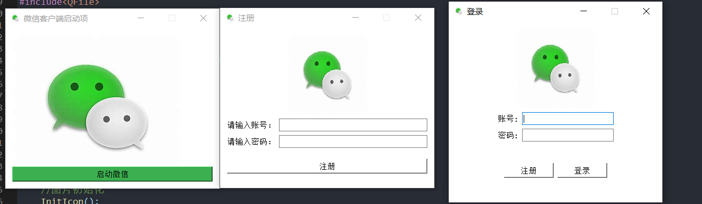
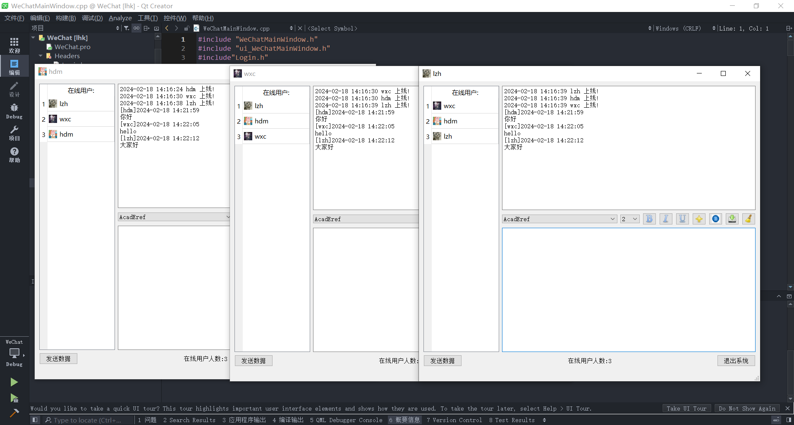
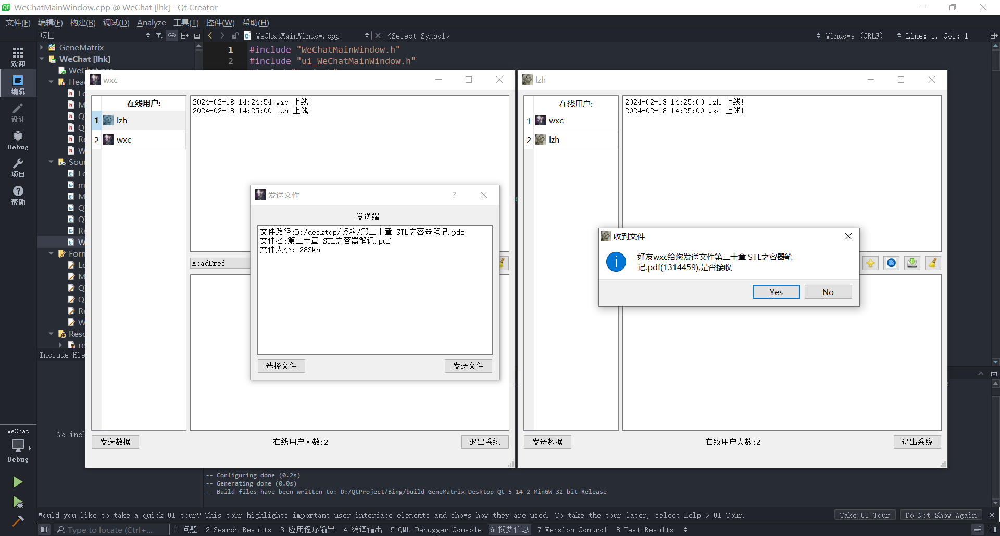
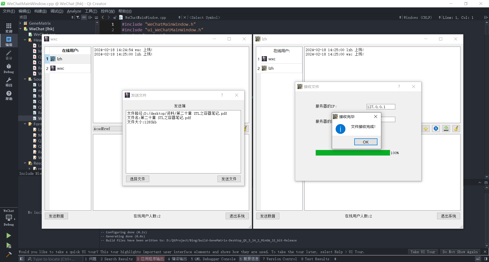

# Qt_Project

#### 介绍
基于Qt的仿微信聊天系统
目前已经实现了以下主要功能：
1.账号登录注册及验证功能
2.基于UDP的群聊功能
3.基于TCP的私聊文件传输功能
4.聊天字体的字体、字号、粗体、斜体、下划线、颜色等功能
5、保存聊天记录，清空聊天内容

#### 安装教程

提供了绿色版按照文件压缩包exe.zip
可直接使用的安装包weChat1.0-setup.exe
以及全套源码WeChat

提示：安均已更新2.0版本

#### 使用说明

已注册账号可查看源码中的user.txt文件
可使用Enter/Esc快捷键，发送消息的快捷键为ctrl+Enter
登录多个账号后收发消息、文件
测试账号
hdm    123
wxc    123    
lzh    123

#### 成果展示

1.启动注册登录界面

2.聊天主界面

3.文件发送

